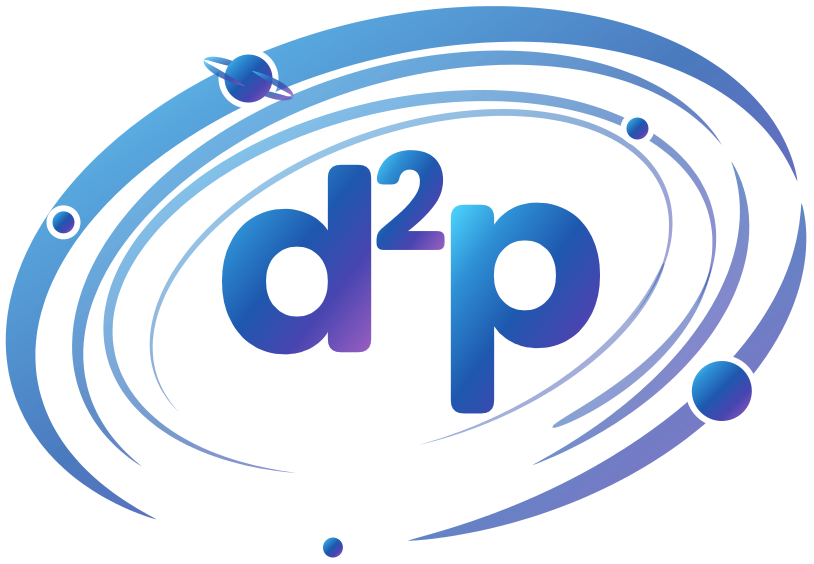

<p align="center">
  <br>
  <strong>Differentiable Dynamic Programming for PyTorch</strong><br>
  CPU and CUDA operators for alignment, parsing, and edit-distance style workloads.
</p>

<p align="center">
  <a href="https://openreview.net/forum?id=ZPtK8LKcvi"></a>
  <a href="https://www.python.org/downloads/"></a>
  <a href="https://pytorch.org/"></a>
  <a href="https://www.apache.org/licenses/LICENSE-2.0"></a>
</p>

d2p provides differentiable dynamic programming operators for PyTorch across sequence alignment, parsing, monotonic alignment, and edit-distance families. The public API is high-level first (`d2p.soft_sw`, `d2p.soft_dtw`, `d2p.soft_cky`, ...), with matching `nn.Module` wrappers, `torch.compile` support, and low-level operators under `d2p.ops`.

## Installation

### Prebuilt binaries (recommended)

Install a matching PyTorch first — each binary is locked to the exact PyTorch it was
built against (`libc10`/`libtorch` symbols change every PyTorch minor). Then install
d2p from the wheel index, picking the lane for your PyTorch + CUDA:

```bash
pip install py-d2p --extra-index-url https://download.orikata.ai/whl/torch2.13/cu130/
```

Swap `torch2.13/cu130` for your lane:

| PyTorch | CUDA lanes |
|---------|------------|
| 2.9  | cpu · cu126 · cu128 · cu129 · cu130 |
| 2.10 | cpu · cu126 · cu128 · cu129 · cu130 |
| 2.11 | cpu · cu126 · cu128 · cu129 · cu130 |
| 2.12 | cpu · cu126 · cu129 · cu130 · cu132 |
| 2.13 | cpu · cu126 · cu129 · cu130 · cu132 |

Not sure which lane? This detects it from your installed PyTorch:

```bash
pip install py-d2p --extra-index-url "https://download.orikata.ai/whl/$(python -c "import torch;v='.'.join(torch.__version__.split('+')[0].split('.')[:2]);c=torch.version.cuda;print(f'torch{v}/'+('cpu' if not c else 'cu'+c.replace('.','')))")/"
```

The distribution is named `py-d2p` (`d2p` is taken on PyPI); the **import name is
still `d2p`**. Use `--extra-index-url`, not `--index-url`, so PyPI still resolves your
other dependencies. Pin a version with `py-d2p==0.1.0` (keep the `--extra-index-url`).

**conda** — the same matrix from one channel:

```bash
conda install -c https://download.orikata.ai/conda d2p
```

conda selects the build matching your installed PyTorch and platform automatically.


### Build from source

Alternatively, build against your installed PyTorch directly.

Install a matching PyTorch build first, then build d2p from source. The extension compiles against your installed PyTorch, so build with `--no-build-isolation` (after installing the build backend):

```bash
pip install meson-python meson ninja        # build backend
git clone https://github.com/orikata-bio/d2p.git
cd d2p
pip install . --no-build-isolation --no-cache-dir   # builds against your installed PyTorch
```

`--no-build-isolation` is required, not optional. The extension registers ops
through `TORCH_LIBRARY` and is locked to the exact PyTorch it compiles against,
because `libc10`/`libtorch` symbol versions change every PyTorch minor release.
Under PEP 517 build isolation pip installs its *own* (latest) PyTorch into a
temporary build environment and compiles against that instead of yours; the
install then reports success and the mismatch only appears later as an
`undefined symbol` error on `import d2p`.

`--no-cache-dir` matters for the same reason: pip keys its wheel cache on the
source distribution, not on the PyTorch it was built against, so an incompatible
wheel built earlier is silently reused even after you correct the command.

Requirements:

- Python `3.10` through `3.14`
- PyTorch `2.0+` (install the CPU or CUDA build for your platform first)
- CUDA builds also need a CUDA toolkit matching your PyTorch CUDA version

CUDA builds compile device code for NVIDIA architectures from Turing (`sm_75`) through Blackwell (`sm_121`), selectable at build time. For editable installs, architecture selection, and custom toolchains, see [docs/source-build.md](docs/source-build.md).

## Quick Start

```python
import torch
import d2p

device = "cuda" if torch.cuda.is_available() else "cpu"
scores = torch.randn(2, 100, 120, device=device, requires_grad=True)

result = d2p.soft_sw(scores, gap=-1.0, temperature=1.0)

print(result.value.shape)      # [2]
print(result.marginals.shape)  # [2, 100, 120]

loss = result.value.sum()
loss.backward()
```

The same high-level calls work under `torch.compile` on supported PyTorch `2.x` builds.

## Algorithm Guides

d2p ships 12 operators across seven guide families:

| Family | Public APIs | Guide |
| --- | --- | --- |
| Smith-Waterman | `soft_sw`, `soft_sw_affine` | [docs/algorithms/sw.md](docs/algorithms/sw.md) |
| Needleman-Wunsch | `soft_nw`, `soft_nw_affine` | [docs/algorithms/nw.md](docs/algorithms/nw.md) |
| Dynamic Time Warping | `soft_dtw` | [docs/algorithms/dtw.md](docs/algorithms/dtw.md) |
| CKY | `soft_cky` | [docs/algorithms/cky.md](docs/algorithms/cky.md) |
| Monotonic Alignment Search | `soft_mas` | [docs/algorithms/mas.md](docs/algorithms/mas.md) |
| Eisner | `soft_eisner` | [docs/algorithms/eisner.md](docs/algorithms/eisner.md) |
| Edit distance | `soft_levenshtein`, `soft_lcs`, `soft_osa`, `soft_damerau` | [docs/algorithms/edit-distance.md](docs/algorithms/edit-distance.md) |

**More docs:** [Concepts](docs/concepts.md) (differentiable-DP background) | [Usage Guide](docs/usage.md) (batching, masks, learnable params, modules, AMP, temperature) | [Examples](docs/examples.md) (end-to-end tutorials) | [Performance](docs/performance.md) (complexity, threading, arch) | [FAQ](docs/faq.md) | [Source builds](docs/source-build.md)

## Features

Three API levels, highest to lowest:

- **High-level functions** — `d2p.soft_sw(...)`, `d2p.soft_dtw(...)`, `d2p.soft_cky(...)`, returning result objects with named fields (`.value`, `.marginals`, `.score`, `.alignment`, `.distance`, by family).
- **`nn.Module` wrappers** — `d2p.SoftSW`, `d2p.SoftDTW`, `d2p.SoftMAS`, `d2p.SoftLevenshtein`, ... for learnable parameters and model composition.
- **Low-level ops** — `d2p.ops` for structured access, plus the legacy `torch.ops.d2p.*` / `d2p._ops` surface.

Across the shipped families you get gradients through inputs and scalar hyperparameters, Hessian-vector products, and first-order parameter Jacobians where the family exposes them. CPU kernels are multithreaded: each batch element's dynamic program runs across PyTorch's intra-op threads (`torch.set_num_threads`). Both CUDA and CPU kernels are memory-safety hardened, with length/shape/device validation at every op boundary, `size_t`-widened indexing, and multi-GPU device guards.

See the [Usage Guide](docs/usage.md) for each level in depth: learnable parameters, AMP, temperature, and the low-level derivative surfaces (`_with_grads`, `_hvp`, `_param_jacobian`).

## Scope Notes

`0.1.0` ships the stable public package surface: forward ops, autograd, HVPs, and first-order parameter Jacobians where exposed by the family API. Some broader paper-side or mixed-derivative surfaces are intentionally not part of the `0.1.0` public API yet.

## Citation

d2p accompanies the paper **[d²p: Structured Soft Attention Is All You Need](https://openreview.net/forum?id=ZPtK8LKcvi)** (ICML 2026). If you use d2p in your research, please cite it.

- OpenReview: <https://openreview.net/forum?id=ZPtK8LKcvi>
- ICML 2026 poster: <https://icml.cc/virtual/2026/poster/63172>

```bibtex
@inproceedings{mogilevsky2026d2p,
  title     = {{d\textsuperscript{2}p: Structured Soft Attention Is All You Need}},
  author    = {Mogilevsky, Casey Sumagaysay and Liang, Kimberly},
  booktitle = {Proceedings of the 43rd International Conference on Machine Learning (ICML)},
  series    = {Proceedings of Machine Learning Research},
  year      = {2026},
  publisher = {PMLR},
  url       = {https://openreview.net/forum?id=ZPtK8LKcvi},
}
```

## License

Apache License 2.0. See [LICENSE](LICENSE) and [NOTICE](NOTICE).
